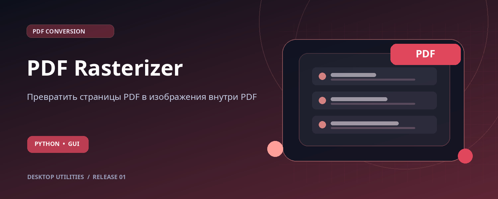

<div align="center">



# PDF Rasterizer

### Превратить страницы PDF в изображения внутри PDF

Пакетное растрирование PDF с выбором DPI и сохранением размеров страниц.

  

**[📦 Скачать последнюю версию](https://github.com/kolbaska11/pdf-to-image-pdf/releases/latest)** · [🚀 Установка](#-быстрый-старт) · [✨ Возможности](#-возможности) · [🛠 Настройки](#-настройки-и-нюансы)

</div>

---

## ✨ Возможности

| | |
|---|---|
| **Пакетное преобразование** | Обрабатывает несколько PDF подряд. |
| **Выбор DPI** | Предустановки 100, 150 и 200 DPI. |
| **Исходные страницы** | Сохраняет размеры и последовательность страниц. |
| **Прогресс** | Показывает ход обработки и итоговый статус. |

## 🎯 Для каких задач

Подготовка копии PDF с зафиксированным внешним видом страниц для передачи и просмотра.

## 🚀 Быстрый старт

**ОС:** Windows 10/11. **Python:** рекомендовано 3.11–3.12. Интернет нужен для первоначальной установки зависимостей.

1. Откройте [**Releases**](https://github.com/kolbaska11/pdf-to-image-pdf/releases/latest) и скачайте ZIP-архив версии.
2. Распакуйте архив в отдельную папку.
3. Запустите **`start_windows.bat`** двойным щелчком. `start_windows.bat` автоматически создаст локальное окружение `.venv` и установит зависимости при первом запуске.
4. Следуйте шагам ниже — графический интерфейс откроется автоматически.

### Пошаговое использование

1. Выберите один или несколько PDF-файлов.
2. Укажите папку результатов и разрешение (100 / 150 / 200 DPI).
3. Нажмите «Преобразовать» — готовые файлы появятся с суффиксом `_raster.pdf`.

**Альтернативный запуск через терминал** (из папки проекта):

```powershell
python -m pip install -r requirements.txt
python pdf_to_image_pdf.py
```

## 🗂 Пример работы

| Исходные файлы | Результат |
|---|---|
| `catalog.pdf` | `catalog_raster.pdf` |

## 🔧 Требования и зависимости

Python 3.11 или 3.12 (64-bit), Windows 10/11 и Tcl/Tk, входящий в стандартный установщик Python. В других средах алгоритмы могут работать, но Windows-запускатор и полный интерфейс там не проверены.

| Компонент | Назначение |
|---|---|
| `PyMuPDF` | Рендер страниц и сборка нового PDF |

Пакеты перечислены в [`requirements.txt`](requirements.txt). Для ручного запуска используйте один и тот же Python при установке и запуске. Если установлен Python 3.14 и библиотека не устанавливается, создайте окружение на 3.12: `py -3.12 -m venv .venv`, затем запустите BAT. Для проверки Tkinter выполните `python -m tkinter`.

## 🛠 Настройки и нюансы

Результат состоит из изображений страниц: **текст больше нельзя выделять как текст**, а при увеличении качество ограничено выбранным DPI. Это не инструмент повышения чёткости или уменьшения размера файла.

> [!NOTE]
> Программа запускается локально на компьютере. Обрабатываемые файлы не отправляются в облачный сервис этой утилитой. При установке пакетов и, если используется, скачивании нейросетевой модели потребуется подключение к интернету.

## ⚠️ Известные ограничения

Изображения формируются в RGB с белым непрозрачным фоном. Размеры видимых страниц и порядок сохраняются; отдельные печатные боксы, закладки, ссылки, формы, подписи и исходная структура PDF не переносятся. OCR отсутствует. Защищённые паролем PDF отклоняются. Размер результата может вырасти; большие страницы при 200 DPI требуют много памяти. Во время обработки дождитесь окончания перед закрытием окна.

## 📂 Структура проекта

```text
pdf-to-image-pdf/
├── pdf_to_image_pdf.py
├── requirements.txt
├── start_windows.bat
├── assets/
│   └── hero.jpg
├── README.md
├── RELEASE_NOTES.md        # Установка и описание выпуска
└── docs/VALIDATION.md      # Объём выполненной проверки
```

## ✅ Проверка версии

Результаты аудита и ограничения тестирования приведены в [docs/VALIDATION.md](docs/VALIDATION.md). Полная ручная проверка Windows GUI в этой среде не выполнялась.

## ❓ Частые вопросы

<details>
<summary><b>Нужно ли собирать .exe?</b></summary>

Нет. Готовый релиз содержит Python-скрипт и Windows-запускатор. Для работы нужен установленный Python. Файл `start_windows.bat` — не исполняемый EXE.
</details>

<details>
<summary><b>Где находятся готовые файлы?</b></summary>

Точное расположение и правила именования указаны в разделах «Пошаговое использование» и «Известные ограничения».
</details>

<details>
<summary><b>Как сообщить об ошибке?</b></summary>

Откройте раздел **Issues** этого репозитория, укажите версию Python, текст ошибки и последовательность действий. Не прикладывайте личные документы и конфиденциальные файлы.
</details>

---

<div align="center"><sub>Made for a simpler file workflow · Python desktop utility</sub></div>
